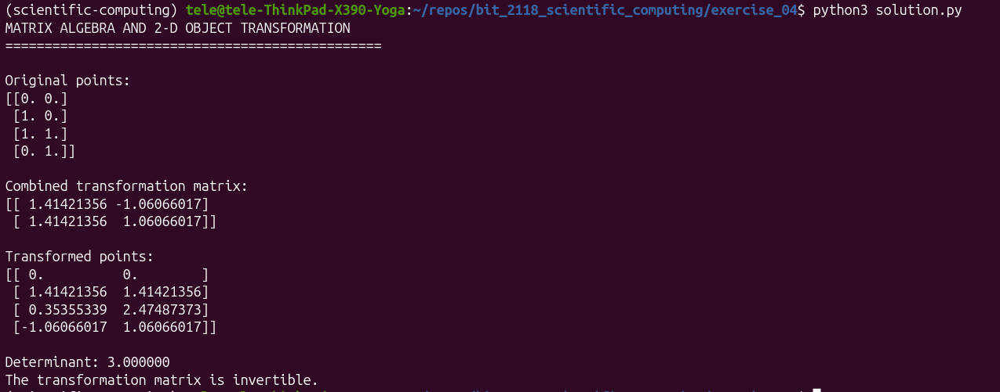

# Exercise 04: Matrix Algebra and Matrix Operations

## 1. Directory & Metadata

- **Exercise:** 04
- **Topic:** Matrix Algebra and Matrix Operations
- **Programming Language:** Python 3
- **Library:** NumPy
- **Application Area:** Computer Graphics and 2-D Geometric Transformations

## 2. Concept Overview

A matrix is a rectangular arrangement of numerical values organized into rows and columns. Matrices are important in scientific computing because they provide an efficient way to represent and perform operations on numerical data.

### Matrix Addition

Matrix addition combines corresponding elements of two matrices of the same dimensions.

For example:

$$
A =
\begin{bmatrix}
1 & 2\\
3 & 4
\end{bmatrix},
\quad
B =
\begin{bmatrix}
5 & 6\\
7 & 8
\end{bmatrix}
$$

$$
A+B =
\begin{bmatrix}
6 & 8\\
10 & 12
\end{bmatrix}
$$

### Matrix Multiplication

Matrix multiplication combines rows of the first matrix with columns of the second matrix. For matrices \(A\) and \(B\), the elements of their product are calculated as:

$$
C_{ij} = \sum_k A_{ik}B_{kj}
$$

The number of columns in the first matrix must equal the number of rows in the second matrix.

### Determinant

The determinant is a scalar value calculated from a square matrix. It helps determine whether a matrix is invertible.

For a 2 × 2 matrix:

$$
A =
\begin{bmatrix}
a & b\\
c & d
\end{bmatrix}
$$

$$
\det(A) = ad-bc
$$

If the determinant is zero, the matrix is singular and does not have an inverse.

### Matrix Inverse

The inverse of a square matrix \(A\), written as $A^{-1}$, is a matrix that satisfies:

$$
AA^{-1}=A^{-1}A=I
$$

where \(I\) is the identity matrix.

### Example

Given:

$$
A =
\begin{bmatrix}
1 & 2\\
3 & 4
\end{bmatrix},
\quad
x =
\begin{bmatrix}
5\\
6
\end{bmatrix}
$$

Matrix multiplication gives:

$$
Ax =
\begin{bmatrix}
(1 \times 5)+(2 \times 6) \\
(3 \times 5)+(4 \times 6)
\end{bmatrix}
=
\begin{bmatrix}
17 \\
39
\end{bmatrix}
$$

### Real-World Applications

Matrix algebra is used in several areas of computing, science and engineering:

- **Computer Graphics:** Rotating, scaling and translating objects in 2-D and 3-D environments.
- **Machine Learning:** Representing datasets, weights and mathematical transformations.
- **Robotics:** Representing positions, orientations and coordinate transformations.
- **Cryptography:** Applying matrix-based mathematical operations in certain encryption methods.
- **Electrical Engineering:** Representing and solving systems of circuit equations.
- **Network Analysis:** Modelling relationships and connections using adjacency matrices.

## 3. Problem Statement and Solution Approach

### Problem: 2-D Object Transformation in Computer Graphics

A computer graphics program needs to rotate and scale a square object represented by four coordinate points.

The original square has the following coordinates:

$$
P =
\begin{bmatrix}
0 & 0\\
1 & 0\\
1 & 1\\
0 & 1
\end{bmatrix}
$$

The program must:

1. Represent the four corners of the square as coordinate vectors.
2. Construct a rotation matrix for a 45-degree counterclockwise rotation.
3. Construct a scaling matrix that doubles the horizontal dimension and increases the vertical dimension by a factor of 1.5.
4. Combine the rotation and scaling matrices.
5. Transform all four coordinate points using matrix multiplication.
6. Calculate the determinant of the combined transformation matrix.

### Mathematical Approach

**Rotation matrix**

For a rotation angle $theta$

$$
R =
\begin{bmatrix}
\cos\theta & -\sin\theta\\
\sin\theta & \cos\theta
\end{bmatrix}
$$

For a 45-degree rotation:

$$
\theta = 45^\circ
$$

**Scaling matrix**

$$
S =
\begin{bmatrix}
2 & 0\\
0 & 1.5
\end{bmatrix}
$$

**Combined transformation**

The scaling transformation is applied first, followed by rotation:

$$
T = R \times S
$$

Since the coordinate points are stored as row vectors, the transformed points are calculated using:

$$
P_{\text{transformed}} = P \times T^T
$$

where \(T^T\) is the transpose of the combined transformation matrix.

**Determinant**

The determinant of the combined transformation matrix is calculated using:

$$
\det(T)
$$

This indicates whether the transformation matrix is invertible.

### Python Implementation

The program uses NumPy to construct the matrices, perform matrix multiplication, transform the coordinate points and calculate the determinant

## 4. Program Output

The screenshot below shows the actual output generated by executing `solution.py`.

