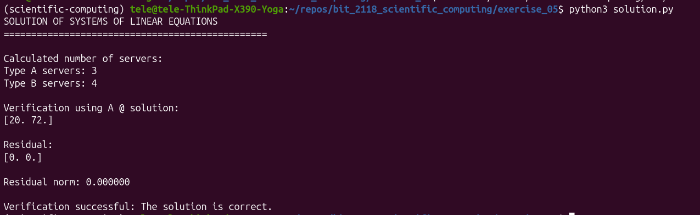

# Exercise 05: Solution of Systems of Linear Equations

- **Programming Language:** Python
- **Library:** NumPy

## 1. Mathematical Concept

A system of linear equations consists of two or more linear equations that share unknown variables.

In scientific computing, these systems can be represented using matrix notation:

$$
Ax=b
$$

Where:

- **A** is the coefficient matrix containing the coefficients of the unknown variables.
- **x** is the vector containing the unknown variables.
- **b** is the constant vector containing the known results.

Solving the system means finding the values of the unknown variables in vector **x** such that multiplying matrix **A** by **x** produces vector **b**.

For a system with two unknowns:

$$
\begin{aligned}
a_1x+b_1y&=c_1\\
a_2x+b_2y&=c_2
\end{aligned}
$$

The matrix representation is:

$$
\begin{bmatrix}
a_1 & b_1\\\
a_2 & b_2
\end{bmatrix}
\begin{bmatrix}
x\\\
y
\end{bmatrix}
=
\begin{bmatrix}
c_1\\\
c_2
\end{bmatrix}
$$

### Solving a System of Linear Equations Using NumPy

NumPy provides the `numpy.linalg.solve()` function for solving systems of linear equations.

The general syntax is:

```python
solution = np.linalg.solve(A, b)
```

The function calculates the values of the unknown variables in the system \(Ax=b\).

A valid unique solution exists when the coefficient matrix is square and non-singular.

### Example

Consider the following simultaneous equations:

$$
2x+3y=8
$$

$$
4x+y=6
$$

The coefficient matrix and constant vector are:

$$
A=
\begin{bmatrix}
2 & 3\\
4 & 1
\end{bmatrix}
\qquad
b=
\begin{bmatrix}
8\\
6
\end{bmatrix}
$$

The solution is:

$$
x=1,\qquad y=2
$$

Verification:

$$
2(1)+3(2)=8
$$

$$
4(1)+2=6
$$

Both equations are satisfied. Therefore, the solution is correct.

## 2. Real-World Applications

Systems of linear equations are used in several scientific and engineering applications, including:

- **Electrical circuit analysis:** Determining unknown currents and voltages in electrical networks.
- **Resource allocation:** Distributing limited resources while satisfying multiple requirements.
- **Traffic-flow models:** Estimating traffic distribution across interconnected roads.
- **Chemical equations:** Balancing chemical reactions.
- **Computer graphics:** Performing transformations involving coordinate systems.
- **Parameter estimation:** Determining unknown values from a system of mathematical relationships.

## 3. Real-World Problem

### Problem Statement

A computing environment uses two types of servers to process workloads.

Each server type consumes different amounts of CPU resources and memory:

| Resource | Type A Server | Type B Server |
|---|---:|---:|
| CPU usage | 4 units | 2 units |
| Memory usage | 8 GB | 12 GB |

The total observed resource consumption is:

- Total CPU usage: 20 units
- Total memory usage: 72 GB

The objective is to determine how many Type A and Type B servers are active based on the observed resource consumption.

### Mathematical Formulation

Let:

- \(x\) = number of Type A servers.
- \(y\) = number of Type B servers.

From the CPU usage, we obtain:

$$
4x+2y=20
$$

From the memory usage, we obtain:

$$
8x+12y=72
$$

These equations can be represented in matrix form:

$$
\begin{bmatrix}
4 & 2\\
8 & 12
\end{bmatrix}
\begin{bmatrix}
x\\
y
\end{bmatrix}
=
\begin{bmatrix}
20\\
72
\end{bmatrix}
$$

Therefore:

$$
A=
\begin{bmatrix}
4 & 2\\
8 & 12
\end{bmatrix}
$$

$$
x=
\begin{bmatrix}
x\\
y
\end{bmatrix}
\qquad
b=
\begin{bmatrix}
20\\
72
\end{bmatrix}
$$

### Solution Approach

The problem is solved using NumPy's linear algebra functionality.

The following steps are performed:

1. Import the NumPy library.
2. Create the coefficient matrix `A` containing the CPU and memory coefficients.
3. Create the constant vector `b` containing the total CPU and memory usage.
4. Use `np.linalg.solve(A, b)` to calculate the unknown number of servers.
5. Calculate the residual to measure the difference between the observed resource totals and the calculated totals.
6. Verify the solution using matrix multiplication with `A @ solution`.
7. Display the calculated server quantities and verification results.

### Mathematical Verification

The calculated solution is:

$$
x=3,\qquad y=4
$$

Substituting these values into the original equations:

CPU verification:

$$
4(3)+2(4)=20
$$

Memory verification:

$$
8(3)+12(4)=72
$$

Both equations are satisfied.

The residual is calculated using:

$$
r=b-Ax
$$

A residual of zero indicates that the calculated solution reproduces the given resource totals exactly, subject to numerical precision.

The residual norm is calculated using:

$$
\|r\|_2=\sqrt{r_1^2+r_2^2}
$$

## 4. Python Implementation

The solution is implemented in Python using NumPy's `linalg.solve()` function.

The program determines the number of active servers of each type and verifies the calculated solution using matrix multiplication and residual calculations.

**Program file:** `exercise_05/solution.py`

## 5. Program Output

The following screenshot shows the actual output obtained after executing the Python program.


