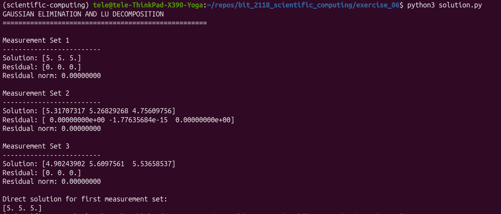

# Exercise 06: Gaussian Elimination and LU Decomposition

- **Programming Language:** Python
- **Libraries:** NumPy and SciPy

## 1. Mathematical Concept

Gaussian elimination and LU decomposition are numerical methods used to solve systems of linear equations.

A system of linear equations can be represented in matrix form as:

```math
Ax=b
```

Where:

- **A** is the coefficient matrix.
- **x** is the vector of unknown variables.
- **b** is the vector of known constants.

### Gaussian Elimination

Gaussian elimination is a method of solving a system of linear equations by transforming its coefficient matrix into an upper-triangular form.

The process involves two main stages:

1. **Forward elimination:** Variables are eliminated one at a time from the lower rows of the matrix until an upper-triangular system is obtained.
2. **Back-substitution:** The unknown variables are calculated starting from the last equation and working upwards.

An upper-triangular matrix has zeros below its main diagonal.

For example:

```math
U=
\begin{bmatrix}
a_{11} & a_{12} & a_{13}\\
0 & a_{22} & a_{23}\\
0 & 0 & a_{33}
\end{bmatrix}
```

For a system of three equations, elimination first removes the variable \(x\) from the second and third equations. It then removes \(y\) from the third equation.

The final equation gives the value of \(z\). Back-substitution is then used to calculate \(y\) and \(x\).

### LU Decomposition

LU decomposition is a method of factorizing a square matrix into two triangular matrices:

```math
A=LU
```

Where:

- **L** is a lower-triangular matrix.
- **U** is an upper-triangular matrix.

With partial pivoting, the factorization is commonly represented as:

```math
PA=LU
```

Where **P** is a permutation matrix that represents row exchanges made during factorization.

Once the matrix has been factorized, the original system:

```math
Ax=b
```

Can be solved in two stages:

First, solve:

```math
Ly=Pb
```

Then solve:

```math
Ux=y
```

The intermediate vector \(y\) is used to obtain the final solution \(x\).

### Why LU Decomposition Is Useful

LU decomposition is particularly useful when several systems have the same coefficient matrix but different constant vectors.

Instead of repeatedly performing the entire elimination process, the matrix can be factorized once and the resulting factors reused.

This reduces repeated computational work.

SciPy provides the following functions:

```python
from scipy.linalg import lu_factor, lu_solve
```

- `lu_factor(A)` computes and stores the LU factorization of matrix `A`.
- `lu_solve((lu, piv), b)` uses the stored factorization to solve the system for a given vector `b`.

## 2. Real-World Applications

Gaussian elimination and LU decomposition are used in several scientific and engineering applications:

- **Engineering simulations:** Solving mathematical models involving interconnected physical systems.
- **Finite-element methods:** Solving large systems of equations used in structural and mechanical analysis.
- **Economic models:** Analyzing relationships between different economic variables.
- **Scientific computing:** Solving systems of equations in numerical simulations.
- **Electrical engineering:** Analyzing networks of electrical components.
- **Repeated linear-system solutions:** Efficiently solving multiple systems that share the same coefficient matrix.

## 3. Real-World Problem

### Problem Statement

A scientific simulation uses a fixed coefficient matrix to represent relationships between three unknown system variables.

The simulation receives new measurement vectors at different time intervals. Although the measurement values change, the coefficient matrix remains the same.

The objective is to solve the system for each measurement vector efficiently without repeating the entire matrix factorization process.

### Mathematical Formulation

The coefficient matrix is:

```math
A=
\begin{bmatrix}
4 & -1 & 0\\
-1 & 4 & -1\\
0 & -1 & 3
\end{bmatrix}
```

The simulation receives three different measurement vectors.

**Measurement Set 1:**

```math
b_1=
\begin{bmatrix}
15\\
10\\
10
\end{bmatrix}
```

**Measurement Set 2:**

```math
b_2=
\begin{bmatrix}
16\\
11\\
9
\end{bmatrix}
```

**Measurement Set 3:**

```math
b_3=
\begin{bmatrix}
14\\
12\\
11
\end{bmatrix}
```

Each measurement vector produces a separate system of linear equations:

```math
Ax_1=b_1
```

```math
Ax_2=b_2
```

```math
Ax_3=b_3
```

The coefficient matrix remains unchanged, while the measurement vector changes.

### Solution Approach

The problem is solved using SciPy's LU decomposition functions and NumPy's matrix operations.

The following steps are performed:

1. Import NumPy and the `lu_factor` and `lu_solve` functions from SciPy.
2. Create the coefficient matrix `A`.
3. Define the three measurement vectors.
4. Factorize the coefficient matrix once using `lu_factor(A)`.
5. Use the stored LU factors to solve each system with `lu_solve()`.
6. Calculate the residual for each solution to measure the difference between the original measurement vector and the reconstructed values.
7. Calculate the residual norm to evaluate the accuracy of each solution.
8. Compare the first LU-based solution with a direct solution obtained using `np.linalg.solve()`.

### Mathematical Verification

For each measurement vector, the solution is obtained by solving:

```math
Ax=b
```

The calculated solution is substituted back into the original system using matrix multiplication:

```math
Ax
```

The residual is calculated as:

```math
r=b-Ax
```

A residual close to zero indicates that the calculated solution satisfies the original system.

The residual norm is calculated using:

```math
\|r\|_2=\sqrt{r_1^2+r_2^2+r_3^2}
```

A small residual norm indicates that the solution is numerically accurate.

## 4. Python Implementation

The program uses SciPy's `lu_factor()` function to factorize the coefficient matrix once.

It then uses `lu_solve()` to solve the three systems using the same stored factors.

NumPy is used for matrix multiplication, residual calculations, and comparison with a direct solution.

**Program file:** `exercise_06/solution.py`

## 5. Program Output

The following screenshot shows the actual output obtained after executing the Python program.


