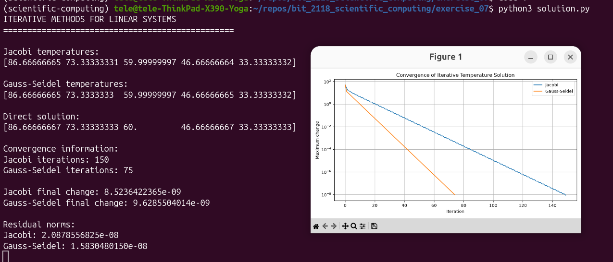

# Exercise 07: Iterative Methods for Linear Systems

- **Programming Language:** Python
- **Libraries:** NumPy and Matplotlib

## 1. Mathematical Concept

Iterative methods are numerical techniques used to solve systems of linear equations by starting with an initial estimate and repeatedly improving it until an acceptable level of accuracy is achieved.

A system of linear equations can be represented in matrix form as:

```math
Ax=b
```

Where:

- **A** is the coefficient matrix.
- **x** is the vector of unknown variables.
- **b** is the vector of known constants.

Unlike direct methods, which calculate a solution through operations such as matrix factorization, iterative methods approach the solution through repeated calculations.

Two commonly used iterative methods are the Jacobi method and the Gauss-Seidel method.

### Jacobi Method

The Jacobi method calculates a new estimate for each unknown variable using the values from the previous iteration.

For a system of linear equations, each variable is rearranged so that it is expressed in terms of the other variables.

The general Jacobi iteration formula is:

```math
x_i^{(k+1)}=
\frac{1}{a_{ii}}
\left(
b_i-\sum_{j\ne i}a_{ij}x_j^{(k)}
\right)
```

Where:

- \(x_i^{(k+1)}\) is the new estimate of variable \(i\).
- \(x_j^{(k)}\) represents the estimates from the previous iteration.
- \(a_{ij}\) represents the coefficients in matrix \(A\).
- \(b_i\) is the corresponding constant.
- \(k\) represents the current iteration.

All new estimates are calculated using the values from the previous iteration. The updated values are used together in the next iteration.

### Gauss-Seidel Method

The Gauss-Seidel method also starts with an initial estimate and repeatedly improves the solution.

However, unlike the Jacobi method, it immediately uses newly calculated values when solving the remaining variables in the same iteration.

Its general iteration formula is:

```math
x_i^{(k+1)}=
\frac{1}{a_{ii}}
\left(
b_i
-\sum_{j=1}^{i-1}a_{ij}x_j^{(k+1)}
-\sum_{j=i+1}^{n}a_{ij}x_j^{(k)}
\right)
```

The first summation uses the newly calculated estimates, while the second uses estimates from the previous iteration.

This can allow Gauss-Seidel to converge faster than Jacobi for some systems.

### Convergence and Stopping Criteria

An iterative method repeatedly calculates new estimates until the change between successive iterations is sufficiently small.

In this exercise, the maximum absolute change between successive estimates is measured using the infinity norm:

```math
e^{(k)}=
\left\|
x^{(k+1)}-x^{(k)}
\right\|_{\infty}
```

The iteration stops when:

```math
e^{(k)}<\text{tolerance}
```

The tolerance determines the acceptable level of numerical change between successive estimates.

A smaller tolerance generally requires more iterations to reach the stopping condition.

### Example of Convergence

Consider a sequence of successive estimates for an unknown variable:

```text
1.000
1.800
1.970
1.999
2.000
```

The estimates approach the value 2 as the iterations progress.

This illustrates convergence: the numerical estimates move progressively closer to a stable solution.

## 2. Real-World Applications

Iterative methods are used in several scientific and engineering applications:

- **Heat transfer:** Estimating temperature distributions across materials and surfaces.
- **Electrical networks:** Solving large systems of equations representing electrical circuits.
- **Structural engineering:** Analyzing forces and displacements in complex structures.
- **Image reconstruction:** Reconstructing images from measured data.
- **Scientific simulations:** Solving large mathematical models with many unknown variables.
- **Large sparse systems:** Solving systems in which most matrix coefficients are zero.

Iterative methods are particularly useful for large sparse systems where direct matrix factorization may require significant computational resources.

## 3. Real-World Problem

### Problem Statement

A simplified temperature model represents heat distribution across a material containing five interior grid points.

The left boundary is maintained at 100°C, while the right boundary is maintained at 20°C.

The objective is to estimate the steady-state temperatures at the five interior points using the Jacobi and Gauss-Seidel iterative methods.

The results from both methods will be compared with a direct solution calculated using NumPy.

### Mathematical Formulation

The temperature model is represented by the system:

```math
Ax=b
```

The coefficient matrix is:

```math
A=
\begin{bmatrix}
2 & -1 & 0 & 0 & 0\\
-1 & 2 & -1 & 0 & 0\\
0 & -1 & 2 & -1 & 0\\
0 & 0 & -1 & 2 & -1\\
0 & 0 & 0 & -1 & 2
\end{bmatrix}
```

The boundary influence vector is:

```math
b=
\begin{bmatrix}
100\\
0\\
0\\
0\\
20
\end{bmatrix}
```

The unknown temperature vector is:

```math
x=
\begin{bmatrix}
T_1\\
T_2\\
T_3\\
T_4\\
T_5
\end{bmatrix}
```

Therefore, the system of equations is:

```math
2T_1-T_2=100
```

```math
-T_1+2T_2-T_3=0
```

```math
-T_2+2T_3-T_4=0
```

```math
-T_3+2T_4-T_5=0
```

```math
-T_4+2T_5=20
```

### Solution Approach

The problem is solved using the Jacobi and Gauss-Seidel iterative methods.

The following steps are performed:

1. Import NumPy for matrix operations and Matplotlib for plotting.
2. Create the coefficient matrix `A` and boundary influence vector `b`.
3. Initialize the temperature estimates to zero.
4. Implement the Jacobi method to calculate successive temperature estimates.
5. Implement the Gauss-Seidel method using newly calculated estimates within each iteration.
6. Calculate the maximum change between successive estimates.
7. Stop each method when the change falls below the specified tolerance or the maximum number of iterations is reached.
8. Calculate a direct solution using `np.linalg.solve()` for comparison.
9. Display the temperature estimates obtained from all three approaches.
10. Plot the convergence of both iterative methods using a logarithmic vertical axis.

### Mathematical Verification

The iterative solutions are compared with the direct solution:

```math
x_{\text{exact}}=A^{-1}b
```

The actual numerical calculation is performed using:

```python
np.linalg.solve(A, b)
```

The residual is:

```math
r=b-Ax
```

The residual norm is:

```math
\|r\|_2=
\sqrt{r_1^2+r_2^2+r_3^2+r_4^2+r_5^2}
```

A small residual indicates that the calculated temperatures satisfy the original system of equations with good numerical accuracy.

### Convergence Visualization

Matplotlib is used to display the maximum change between successive estimates for each iteration.

The convergence plot compares:

- **Jacobi:** Maximum change recorded at each iteration.
- **Gauss-Seidel:** Maximum change recorded at each iteration.

A logarithmic vertical axis makes it easier to observe how the error decreases as the number of iterations increases.

## 4. Python Implementation

The program implements both iterative methods and compares their results with NumPy's direct solution.

It also uses Matplotlib to visualize the convergence behaviour of the two methods.

**Program file:** `exercise_07/solution.py`

## 5. Program Output

The following screenshot shows the actual output obtained after executing the Python program.


