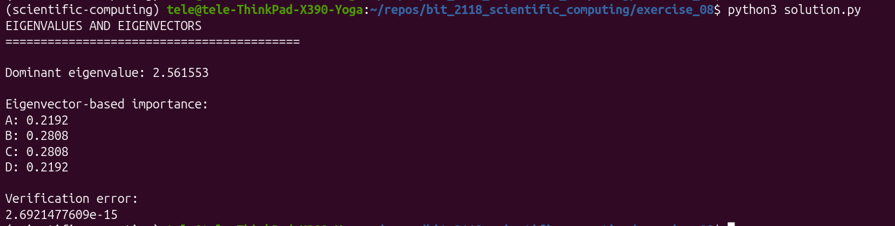

# Exercise 08: Eigenvalues and Eigenvectors

## 1. Mathematical Concept

For a square matrix \(A\), an eigenvector is a non-zero vector whose direction remains unchanged when the matrix transformation is applied to it. It satisfies the equation:

```math
Av = \lambda v
```

Where:

- \(A\) is a square matrix.
- \(v\) is a non-zero eigenvector.
- \(\lambda\) is the eigenvalue corresponding to that eigenvector.

The eigenvalue describes how the eigenvector is scaled by the transformation:

- If \(\lambda > 1\), the vector is stretched.
- If \(0 < \lambda < 1\), the vector is compressed.
- If \(\lambda < 0\), its direction is reversed as well as scaled.
- If \(\lambda = 1\), the vector remains unchanged.

Eigenvalues and eigenvectors are useful for understanding the important structural properties of matrices and the systems they represent.

## 2. Worked Example

Suppose a matrix transformation satisfies:

```math
Av = 3v
```

This means that \(v\) is an eigenvector of matrix \(A\), and its corresponding eigenvalue is:

```math
\lambda = 3
```

Applying the matrix transformation multiplies the eigenvector by three without changing its direction.

## 3. Real-World Applications

Eigenvalues and eigenvectors are applied in several areas of computing, engineering, and scientific research:

- **Google PageRank:** Eigenvector concepts help determine the importance of web pages based on their links.
- **Vibration analysis:** Used to identify natural frequencies and vibration modes in mechanical structures.
- **Stability of dynamical systems:** Eigenvalues help determine whether a system's behaviour is stable or unstable.
- **Principal Component Analysis (PCA):** Eigenvectors help identify important directions of variation in datasets.
- **Image compression:** Used in mathematical techniques that reduce image data while retaining important information.
- **Network centrality:** Eigenvector-based measures estimate the importance of nodes based on their connections to other important nodes.

## 4. Real-World Problem

### Problem Statement

A small computer network contains four connected nodes labelled A, B, C, and D.

The network needs to identify which nodes are structurally more influential based on their connection patterns.

A node connected to other well-connected nodes may be more influential than a node with the same number of connections to less influential nodes.

### Mathematical Model

The network is represented using an adjacency matrix. An adjacency matrix records connections between nodes:

- A value of `1` indicates that two nodes are connected.
- A value of `0` indicates that no direct connection exists.

The adjacency matrix for the network is:

```math
A =
\begin{bmatrix}
0 & 1 & 1 & 0 \\
1 & 0 & 1 & 1 \\
1 & 1 & 0 & 1 \\
0 & 1 & 1 & 0
\end{bmatrix}
```

The node order is:

```math
[A,\ B,\ C,\ D]
```

The matrix is symmetric because the network is undirected: if node A connects to node B, node B also connects to node A.

### Solution Approach

The program uses NumPy to calculate the eigenvalues and eigenvectors of the adjacency matrix.

The steps are:

1. Create the adjacency matrix representing the network.
2. Calculate all eigenvalues and eigenvectors using `numpy.linalg.eig()`.
3. Identify the dominant eigenvalue, which is the eigenvalue with the largest real part.
4. Retrieve its corresponding eigenvector.
5. Use the absolute values of the eigenvector components and normalize them so that their sum equals one.
6. Display the normalized values as eigenvector-based importance scores for nodes A, B, C, and D.
7. Verify the eigenvalue equation by calculating the difference between \(Av\) and \(\lambda v\).

The normalized importance score is calculated as:

```math
C_i = \frac{|v_i|}{\sum_{j=1}^{n}|v_j|}
```

Where:

- \(C_i\) is the importance score of node \(i\).
- \(v_i\) is the corresponding component of the dominant eigenvector.
- \(n\) is the total number of nodes.

The scores sum to one, making the relative importance of the nodes easier to interpret.

## 5. Implementation

The solution is implemented in Python using NumPy.

The `numpy.linalg.eig()` function calculates the eigenvalues and eigenvectors. The dominant eigenvalue and its corresponding eigenvector are then used to calculate the normalized node-importance scores.

The verification error measures how closely the computed eigenpair satisfies:

```math
Av = \lambda v
```

A value close to zero indicates that the eigenvalue equation is satisfied within numerical precision.

## 6. Output Screenshot

The screenshot below shows the actual output produced by executing the Python program.


