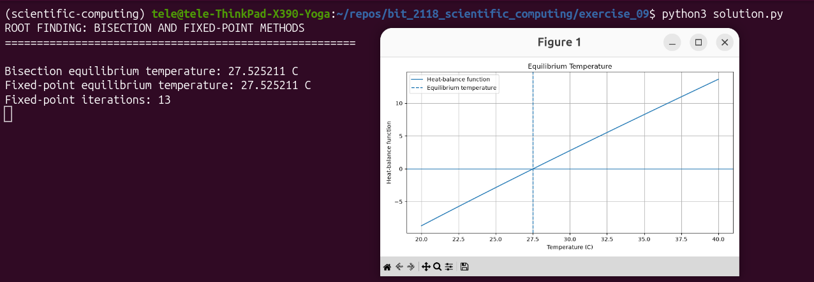

# Exercise 09: Root Finding — Bisection and Fixed-Point Methods

## 1. Mathematical Concept

Root finding is a numerical method used to determine the value of a variable that makes a mathematical function equal to zero.

A root of a function \(f(x)\) is a value \(r\) satisfying:

```math
f(r) = 0
```

This exercise demonstrates two root-finding methods.

### Bisection Method

The bisection method starts with an interval \([a,b]\) in which the function has opposite signs at the endpoints:

```math
f(a) \times f(b) < 0
```

According to the Intermediate Value Theorem, a continuous function must have at least one root within this interval.

The midpoint is calculated using:

```math
c = \frac{a+b}{2}
```

The function is evaluated at the midpoint. The interval is then reduced to the half that contains the sign change.

This process is repeated until the interval width or the function value becomes sufficiently small.

### Fixed-Point Iteration

Fixed-point iteration rewrites an equation into the form:

```math
x = g(x)
```

Starting with an initial estimate \(x_0\), successive approximations are calculated using:

```math
x_{n+1} = g(x_n)
```

The process continues until the difference between successive estimates is below a specified tolerance:

```math
|x_{n+1}-x_n| < \text{tolerance}
```

Both methods approximate the root numerically, but they use different approaches.

## 2. Worked Example

Consider the nonlinear function:

```math
f(x) = x^3-x-2
```

To locate a root, evaluate the function at two points:

```math
f(1) = 1^3-1-2=-2
```

```math
f(2) = 2^3-2-2=4
```

Since the function values have opposite signs, a root lies between 1 and 2.

The first bisection midpoint is:

```math
c = \frac{1+2}{2}=1.5
```

The function is evaluated at this midpoint. The interval is then updated according to the sign of the result.

Repeating this process produces increasingly accurate approximations of the root.

## 3. Real-World Applications

Root-finding methods are used in several scientific, engineering, and financial applications:

- **Break-even analysis:** Determining the point at which revenue equals costs.
- **Engineering equations:** Solving nonlinear equations in engineering designs and simulations.
- **Interest-rate calculations:** Finding interest rates that satisfy financial equations.
- **Calibration:** Determining parameter values that make a model agree with measured observations.
- **Physical equilibrium:** Finding conditions at which forces, energy, or heat balances reach equilibrium.
- **Threshold determination:** Identifying values at which a system reaches a specified condition.

## 4. Real-World Problem

### Problem Statement

A simplified thermal system experiences heat gain and heat loss.

The system reaches thermal equilibrium when the heat-balance function becomes zero. The objective is to determine the equilibrium temperature numerically.

### Mathematical Model

The heat-balance function is defined as:

```math
f(T) = T-25-10e^{-T/20}
```

Where:

- \(T\) represents temperature in degrees Celsius.
- \(25\) represents a constant temperature term in the model.
- \(10e^{-T/20}\) represents the temperature-dependent contribution to the heat balance.

Thermal equilibrium occurs when:

```math
f(T)=0
```

Rearranging the equation gives the fixed-point form:

```math
T = 25+10e^{-T/20}
```

### Solution Approach

The program uses two numerical methods to approximate the equilibrium temperature.

**Bisection Method**

1. Define the heat-balance function.
2. Select an interval from 20°C to 40°C.
3. Evaluate the function at both endpoints to confirm that they have opposite signs.
4. Use SciPy's `root_scalar()` function with the bisection method.
5. Continue halving the interval until the specified tolerance is achieved.

**Fixed-Point Method**

1. Rewrite the heat-balance equation as \(T=g(T)\).
2. Define the iteration function:

```math
g(T)=25+10e^{-T/20}
```

3. Start with an initial temperature estimate of 30°C.
4. Calculate a new estimate using the previous temperature.
5. Record successive estimates in a history list.
6. Stop when the difference between successive estimates is less than the specified tolerance or the maximum number of iterations is reached.

**Comparison and Visualization**

The program displays the equilibrium temperatures obtained using both methods and the number of fixed-point iterations.

It also plots the heat-balance function over the temperature interval from 20°C to 40°C. A horizontal line represents zero heat balance, while a vertical line marks the equilibrium temperature obtained using bisection.

## 5. Implementation

The solution is implemented in Python using NumPy, SciPy, and Matplotlib.

- **NumPy:** Generates temperature values for plotting and supports numerical calculations.
- **SciPy:** Provides the `root_scalar()` function used to implement the bisection method.
- **Matplotlib:** Visualizes the heat-balance function and its equilibrium point.

The two methods provide independent numerical approximations of the same equilibrium temperature.

Comparing their results helps demonstrate how different numerical approaches can solve the same nonlinear equation.

## 6. Output Screenshot

The screenshot below shows the actual terminal output and visualization produced by executing the Python program.


