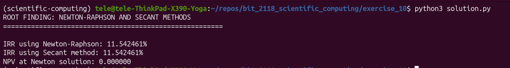

# Exercise 10: Root Finding — Newton-Raphson and Secant Methods

## 1. Mathematical Concept

Root finding is the process of determining a value \(r\) for which a mathematical function equals zero:

```math
f(r)=0
```

This exercise demonstrates two numerical root-finding methods: Newton-Raphson and the Secant method.

### Newton-Raphson Method

The Newton-Raphson method improves an initial estimate by using the derivative of the function.

Its iteration formula is:

```math
x_{n+1}=x_n-\frac{f(x_n)}{f'(x_n)}
```

Where:

- \(x_n\) is the current estimate.
- \(f(x_n)\) is the function value at the current estimate.
- \(f'(x_n)\) is the derivative at the current estimate.
- \(x_{n+1}\) is the improved estimate.

The method uses the tangent line at the current estimate to approximate where the function crosses the horizontal axis.

### Secant Method

The Secant method also improves an estimate of a root, but it does not require an explicitly calculated derivative.

Instead, it estimates the slope using two previous points:

```math
x_{n+1}=x_n-f(x_n)\frac{x_n-x_{n-1}}{f(x_n)-f(x_{n-1})}
```

Where:

- \(x_n\) is the most recent estimate.
- \(x_{n-1}\) is the previous estimate.
- \(f(x_n)\) and \(f(x_{n-1})\) are the corresponding function values.

The Secant method approximates the derivative using the slope of a line through the two points.

Both methods can converge faster than the bisection method when suitable initial estimates are chosen. However, their convergence is not guaranteed for every function or starting estimate.

## 2. Worked Example

Consider the function:

```math
f(x)=x^2-2
```

The objective is to find its root, which is:

```math
x=\sqrt{2}
```

Using the Newton-Raphson method, the derivative is:

```math
f'(x)=2x
```

Starting with an initial estimate:

```math
x_0=1.5
```

The first iteration is:

```math
x_1=1.5-\frac{1.5^2-2}{2(1.5)}
```

```math
x_1=1.5-\frac{0.25}{3}
```

```math
x_1\approx1.4167
```

Repeating the process produces increasingly accurate approximations of the root, approaching:

```math
\sqrt{2}\approx1.4142
```

## 3. Real-World Applications

Newton-Raphson and Secant methods are used in several scientific, engineering, and financial applications:

- **Circuit equations:** Solving nonlinear equations involving electrical components.
- **Optimization:** Solving equations that arise when locating stationary points in optimization problems.
- **Financial calculations:** Finding interest rates that satisfy financial equations, including internal rate of return calculations.
- **Nonlinear models:** Finding solutions to equations that describe complex systems.
- **Calibration:** Estimating parameters that make a mathematical model match observed measurements.
- **Physical equations:** Solving nonlinear equations in engineering and scientific simulations.

## 4. Real-World Problem

### Problem Statement

A financial application needs to determine the internal rate of return (IRR) of an investment.

The investment requires an initial outflow of 10,000 monetary units, followed by annual cash inflows of 3,000, 3,500, 4,000, and 2,500 monetary units.

The IRR is the discount rate that makes the net present value (NPV) of all cash flows equal to zero.

### Mathematical Model

The cash flows are represented as:

```math
[-10000,\ 3000,\ 3500,\ 4000,\ 2500]
```

The NPV function is:

```math
NPV(r)=\sum_{t=0}^{n}\frac{CF_t}{(1+r)^t}
```

Where:

- \(r\) is the discount rate.
- \(CF_t\) is the cash flow at period \(t\).
- \(t\) represents the time period.
- \(n\) is the final cash-flow period.

The objective is to find the rate that satisfies:

```math
NPV(r)=0
```

For the Newton-Raphson method, the derivative of the NPV function is:

```math
NPV'(r)=\sum_{t=1}^{n}\frac{-tCF_t}{(1+r)^{t+1}}
```

### Solution Approach

The program uses two methods to estimate the internal rate of return.

**Newton-Raphson Method**

1. Define the cash flows.
2. Create the NPV function to calculate the present value of the cash flows.
3. Define the derivative of the NPV function.
4. Use an initial rate estimate of 10%.
5. Apply SciPy's `root_scalar()` function with the Newton-Raphson method.
6. Continue updating the rate until the specified tolerance is achieved.

**Secant Method**

1. Reuse the NPV function.
2. Provide two initial rate estimates: 5% and 20%.
3. Apply SciPy's `root_scalar()` function using the Secant method.
4. Estimate the root without explicitly supplying a derivative.
5. Continue until the specified tolerance is achieved.

**Verification**

The program evaluates the NPV at the rate obtained using Newton-Raphson.

A value close to zero indicates that the calculated rate satisfies the NPV equation within numerical precision.

## 5. Implementation

The solution is implemented in Python using SciPy.

The `root_scalar()` function supports both Newton-Raphson and Secant methods.

The Newton-Raphson implementation receives the NPV function, its derivative, and an initial estimate. The Secant implementation receives the NPV function and two initial estimates.

The program displays:

- The IRR calculated using Newton-Raphson.
- The IRR calculated using the Secant method.
- The NPV evaluated at the Newton-Raphson solution.

Comparing the two results demonstrates how different numerical methods can solve the same financial root-finding problem.

## 6. Output Screenshot

The screenshot below shows the actual output produced by executing the Python program.


