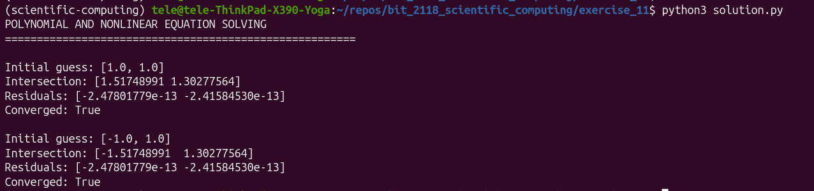

# Exercise 11: Polynomial and Nonlinear Equation Solving

## 1. Mathematical Concept

A polynomial equation is an equation containing variables raised to non-negative integer powers. Its general form is:

```math
a_nx^n+a_{n-1}x^{n-1}+\cdots+a_1x+a_0=0
```

Where:

- \(a_n,a_{n-1},\ldots,a_0\) are constant coefficients.
- \(x\) is the unknown variable.
- \(n\) is the degree of the polynomial.

A nonlinear system contains equations that are not all linear in the unknown variables.

Numerical solvers search for values that make every equation in the system equal to zero, or as close to zero as possible.

For a system of two nonlinear equations, the objective is to find values of \(x\) and \(y\) satisfying:

```math
\begin{aligned}
f_1(x,y)&=0\\
f_2(x,y)&=0
\end{aligned}
```

The numerical solution is an approximation that can be checked by evaluating the residuals of the equations.

## 2. Worked Example

Consider the polynomial equation:

```math
x^2-5x+6=0
```

Factorizing gives:

```math
(x-2)(x-3)=0
```

Therefore, the two roots are:

```math
x=2 \quad \text{or} \quad x=3
```

These values satisfy the original equation because substituting either value produces zero.

For more complicated polynomial and nonlinear equations, numerical methods can be used to approximate solutions when analytical factorization is difficult or unavailable.

## 3. Real-World Applications

Polynomial and nonlinear equation-solving methods are used in several scientific, engineering, and computing applications:

- **Kinematics:** Solving equations describing the motion and position of objects.
- **Chemical equilibrium:** Determining concentrations of substances at equilibrium.
- **Geometric intersection:** Finding where curves or surfaces intersect.
- **Control systems:** Solving nonlinear equations used to analyze system behaviour.
- **Calibration:** Estimating model parameters that match measured data.
- **Operating points:** Finding conditions at which nonlinear systems reach a particular operating state.

## 4. Real-World Problem

### Problem Statement

A geometric modelling application needs to determine the intersection points between a circle and a parabola.

The two curves form a system of nonlinear equations involving the unknown coordinates \(x\) and \(y\).

The objective is to find all relevant intersection points numerically.

### Mathematical Model

The circle is represented by:

```math
x^2+y^2=4
```

The parabola is represented by:

```math
y=x^2-1
```

To solve the system numerically, both equations are rewritten as residual functions.

The circle residual is:

```math
f_1(x,y)=x^2+y^2-4
```

The parabola residual is:

```math
f_2(x,y)=y-(x^2-1)
```

The system can therefore be expressed as:

```math
\begin{aligned}
f_1(x,y)&=x^2+y^2-4=0\\
f_2(x,y)&=y-x^2+1=0
\end{aligned}
```

The intersection coordinates must satisfy both equations simultaneously.

### Solution Approach

The program uses the `root()` function from `scipy.optimize` to solve the nonlinear system.

The steps are:

1. Import NumPy and the `root()` function from SciPy.
2. Define the two residual equations in a function called `equations()`.
3. Provide an initial guess containing estimates for \(x\) and \(y\).
4. Pass the residual function and initial guess to `root()`.
5. Repeat the process using a second initial guess to locate another intersection.
6. Display the initial guesses, calculated intersection coordinates, residuals, and convergence status.
7. Verify that the residual values are close to zero.

Using different initial guesses helps the numerical solver locate different solutions of the nonlinear system.

## 5. Implementation

The solution is implemented in Python using NumPy and SciPy.

- **NumPy:** Supports numerical calculations and residual verification.
- **SciPy:** Provides the `root()` function for solving systems of nonlinear equations.

The `root()` function takes a residual function and an initial estimate of the unknown variables. It attempts to find values that make all residuals sufficiently close to zero.

The program uses two initial guesses:

- `[1.0, 1.0]`
- `[-1.0, 1.0]`

Each guess is used independently to locate an intersection.

The solver's convergence status indicates whether it successfully found a numerical solution. The residual values provide an additional check of the accuracy of each solution.

## 6. Output Screenshot

The screenshot below shows the actual output produced by executing the Python program.


