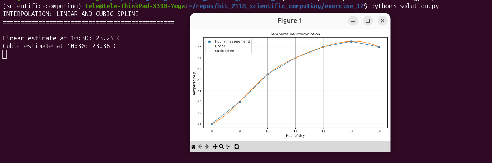

# Exercise 12: Interpolation

## 1. Mathematical Concept

Interpolation is a numerical method used to estimate values between known data points.

It is useful when measurements are available at specific intervals, but additional values are needed between those measurements.

This exercise covers three interpolation techniques.

### Linear Interpolation

Linear interpolation estimates an intermediate value by drawing a straight line between two neighboring data points.

Its formula is:

```math
y = y_0 + \frac{x-x_0}{x_1-x_0}(y_1-y_0)
```

Where:

- \(x_0\) and \(x_1\) are the known input values.
- \(y_0\) and \(y_1\) are their corresponding measurements.
- \(x\) is the intermediate input value.
- \(y\) is the estimated value.

### Polynomial Interpolation

Polynomial interpolation constructs a polynomial that passes through a set of known data points.

For \(n+1\) distinct data points, a polynomial of degree at most \(n\) can be constructed to pass through all the points.

Polynomial interpolation is useful for estimating intermediate values, although high-degree polynomials can sometimes produce unwanted oscillations.

### Cubic Spline Interpolation

Cubic spline interpolation uses separate cubic polynomial functions between neighboring data points.

The curves are joined while maintaining smoothness at the connecting points.

A cubic spline generally maintains continuity of:

- The function values.
- The first derivatives.
- The second derivatives.

This produces a smoother interpolating curve than connecting every pair of points using straight lines.

## 2. Worked Example

Suppose a temperature sensor records:

- 20°C at 10:00.
- 24°C at 12:00.

We want to estimate the temperature at 11:00 using linear interpolation.

The known values are:

```math
\begin{aligned}
x_0 &= 10\\
x_1 &= 12\\
y_0 &= 20\\
y_1 &= 24\\
x &= 11
\end{aligned}
```

Substituting into the linear interpolation formula:

```math
y = 20+\frac{11-10}{12-10}(24-20)
```

Simplifying:

```math
y = 20+\frac{1}{2}(4)
```

Therefore:

```math
y=22^\circ C
```

The estimated temperature at 11:00 is 22°C.

## 3. Real-World Applications

Interpolation is used in several scientific, engineering, and computing applications:

- **Sensor calibration:** Estimating measurements between calibration points.
- **Missing measurement estimation:** Estimating values that were not recorded.
- **Animation:** Generating intermediate positions between keyframes.
- **Geographic data:** Estimating values between known spatial measurements.
- **Lookup tables:** Retrieving approximate values between stored entries.
- **Engineering tables:** Estimating values between experimentally measured data.
- **Signal resampling:** Generating additional samples when changing the sampling interval.

## 4. Real-World Problem

### Problem Statement

A temperature monitoring application receives measurements from a sensor once every hour.

However, another application requires temperature estimates every 10 minutes.

The objective is to estimate the intermediate temperatures using interpolation techniques.

### Data Model

The sensor records the following hourly temperatures:

| Time | Temperature |
|---|---:|
| 08:00 | 18.0°C |
| 09:00 | 20.0°C |
| 10:00 | 22.5°C |
| 11:00 | 24.0°C |
| 12:00 | 25.0°C |
| 13:00 | 25.5°C |
| 14:00 | 25.0°C |

The measurements are represented using two arrays:

- `hours`: Contains the recorded hours.
- `temperature`: Contains the corresponding temperature measurements.

### Solution Approach

The program uses the `scipy.interpolate` module to construct two interpolation functions.

**Linear Interpolation**

1. Import `interp1d` from `scipy.interpolate`.
2. Provide the known hourly measurements.
3. Construct a linear interpolation function.
4. Evaluate the function at intermediate times.

**Cubic Spline Interpolation**

1. Import `CubicSpline` from `scipy.interpolate`.
2. Use the same hourly measurements.
3. Construct a cubic spline interpolation function.
4. Evaluate the function at the same intermediate times.

**Comparison and Visualization**

1. Generate time values at 10-minute intervals from 08:00 to 14:00.
2. Calculate temperature estimates using both interpolation methods.
3. Select 10:30 as a specific time for comparing the estimates.
4. Display both estimates.
5. Plot the original measurements and the two interpolation curves using Matplotlib.

The comparison demonstrates how linear and cubic spline interpolation estimate values between the same known measurements.

## 5. Implementation

The solution is implemented in Python using NumPy, SciPy, and Matplotlib.

- **NumPy:** Creates the measurement arrays and generates intermediate time values.
- **SciPy:** Provides `interp1d()` for linear interpolation and `CubicSpline()` for cubic spline interpolation.
- **Matplotlib:** Displays the original measurements and the interpolated temperature curves.

The program evaluates both interpolation functions at 10-minute intervals.

It also compares the temperature estimates at 10:30, demonstrating how different interpolation techniques can produce different estimates from the same measurements.

Interpolation estimates values within the range of known data points. Estimating values outside that range is called extrapolation and may be less reliable.

## 6. Output Screenshot

The screenshot below shows the actual terminal output and interpolation graph produced by executing the Python program.


