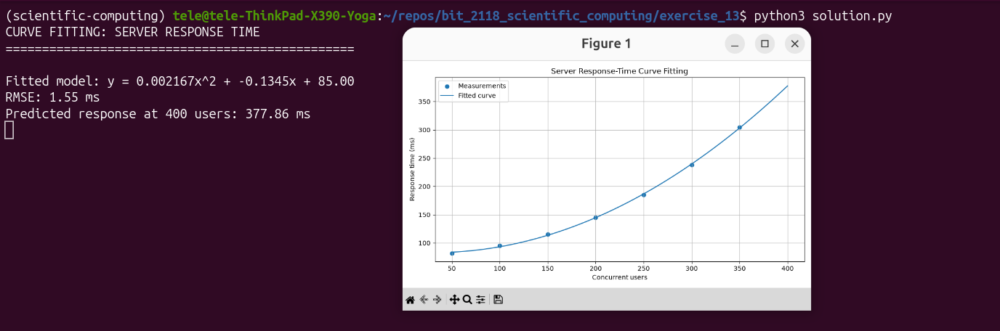

# Exercise 13: Curve Fitting and Approximation

## 1. Mathematical Concept

Curve fitting is a numerical technique used to determine the parameters of a mathematical function that best represents a set of observed data.

In the least-squares method, the parameters are selected to minimize the sum of squared residuals:

```math
S = \sum_{i=1}^{n}(y_i-\hat{y}_i)^2
```

Where:

- \(y_i\) is the observed value.
- \(\hat{y}_i\) is the value predicted by the fitted model.
- \(n\) is the number of observations.
- \(S\) is the sum of squared residuals.

For a linear model:

```math
y = a + bx
```

The parameters \(a\) and \(b\) are chosen to minimize the squared differences between the observed and predicted values.

For this exercise, a quadratic model is used:

```math
y = ax^2 + bx + c
```

The parameters \(a\), \(b\), and \(c\) are estimated using SciPy's `curve_fit()` function.

The quality of the fitted model can be evaluated using the Root Mean Square Error (RMSE):

```math
RMSE = \sqrt{\frac{1}{n}\sum_{i=1}^{n}(y_i-\hat{y}_i)^2}
```

A smaller RMSE generally indicates that the model's predictions are closer to the observed measurements.

## 2. Worked Example

Suppose a server records response times at different numbers of concurrent users.

| Concurrent users | Response time (ms) |
|---:|---:|
| 50 | 82 |
| 100 | 95 |
| 150 | 115 |
| 200 | 145 |
| 250 | 185 |
| 300 | 238 |
| 350 | 305 |

The response time increases as the number of concurrent users increases.

A quadratic model can represent this relationship:

```math
y = ax^2 + bx + c
```

The least-squares method estimates the three parameters so that the fitted curve follows the measured response times as closely as possible.

## 3. Real-World Applications

Curve fitting is useful in:

- **Trend estimation:** Identifying patterns in observed data.
- **Calibration:** Establishing relationships between sensor readings and actual measurements.
- **Performance modelling:** Estimating how system performance changes under different workloads.
- **Growth curves:** Modelling population, business, or biological growth.
- **Demand forecasting:** Estimating future demand from historical observations.
- **Experimental science:** Finding mathematical relationships between measured variables.

## 4. Real-World Problem and Solution Approach

**Problem:**

A server administrator measures the response time of a server at different concurrent user loads. As more users access the server, response time increases.

The administrator wants to establish a mathematical relationship between the number of concurrent users and server response time.

**Solution approach:**

1. Store the measured user loads and response times in NumPy arrays.
2. Define a quadratic model to represent the relationship.
3. Use SciPy's `curve_fit()` to estimate the model parameters.
4. Calculate predicted response times using the fitted model.
5. Calculate the RMSE to evaluate the fitting accuracy.
6. Predict the response time at 400 concurrent users.
7. Plot the measured data and fitted curve for comparison.

## 5. Implementation

The program uses:

- **NumPy:** Stores measurements and calculates the RMSE.
- **SciPy:** Estimates the quadratic model parameters using `curve_fit()`.
- **Matplotlib:** Visualizes the measured data and fitted curve.

The fitted model is used to estimate server response time at a user load of 400. This is an extrapolation because 400 users is outside the range of the original measurements, so the prediction should be treated as an estimate rather than a guaranteed response time.

## 6. Execution Screenshot

The screenshot below shows the program's actual terminal output and the resulting curve-fitting graph.


