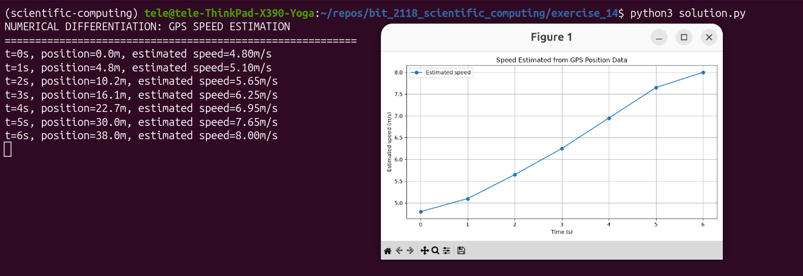

# Exercise 14: Numerical Differentiation

## 1. Mathematical Concept

Numerical differentiation is a technique used to approximate the derivative of a function using nearby data points.

A derivative measures the instantaneous rate of change of a quantity. When an analytical derivative is unavailable, numerical methods can estimate it using small intervals.

Three common finite difference methods are:

**Forward Difference**

Uses the current point and the next point:

```math
f'(x) \approx \frac{f(x+h)-f(x)}{h}
```

**Central Difference**

Uses points on both sides of the current point:

```math
f'(x) \approx \frac{f(x+h)-f(x-h)}{2h}
```

Central difference is generally more accurate than forward difference for the same step size when the function is sufficiently smooth.

**Backward Difference**

Uses the current point and the previous point:

```math
f'(x) \approx \frac{f(x)-f(x-h)}{h}
```

Where:

- \(f(x)\) is the function value at the current point.
- \(h\) is the step size.
- \(f'(x)\) is the estimated derivative.

In this exercise, the derivative of position with respect to time represents the vehicle's speed.

## 2. Worked Example

Suppose a vehicle's position changes from 100 metres to 112 metres over 2 seconds.

The average rate of change is:

```math
v = \frac{112-100}{2}
```

```math
v = 6 \text{ m/s}
```

This means the vehicle travelled at an average speed of 6 metres per second during that interval.

Numerical differentiation applies the same principle to closely spaced measurements to estimate the instantaneous speed at different times.

## 3. Real-World Applications

Numerical differentiation is useful in:

- **Vehicle tracking:** Estimating speed from GPS position measurements.
- **Acceleration estimation:** Calculating acceleration from velocity data.
- **Optimization:** Estimating gradients when analytical derivatives are unavailable.
- **Sensor analysis:** Measuring rates of change in temperature, pressure, and other physical quantities.
- **Sensitivity analysis:** Determining how changes in input variables affect system outputs.
- **Scientific experiments:** Estimating derivatives from recorded experimental measurements.

## 4. Real-World Problem and Solution Approach

**Problem:**

A GPS device records a vehicle's position at one-second intervals. The recorded positions can be used to estimate the vehicle's instantaneous speed at each measurement time.

**Solution approach:**

1. Store the recorded times and corresponding positions in NumPy arrays.
2. Create an array to store the estimated speeds.
3. Apply forward difference at the first measurement.
4. Apply central differences at the interior measurements.
5. Apply backward difference at the final measurement.
6. Display the estimated speed at each time.
7. Plot the estimated speed against time.

## 5. Implementation

The program uses:

- **NumPy:** Stores the GPS measurements and performs numerical calculations.
- **Matplotlib:** Visualizes the estimated speed over time.

The speed is calculated by differentiating position with respect to time numerically.

Different finite difference methods are used at different positions in the dataset because the first and last measurements do not have data points on both sides.

## 6. Execution Screenshot

The screenshot below shows the program's actual terminal output and the resulting speed graph.


