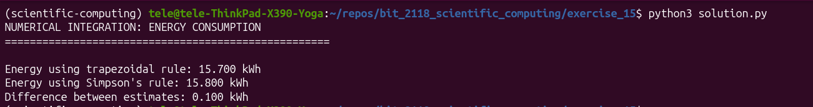

# Exercise 15: Numerical Integration

## 1. Mathematical Concept

Numerical integration is a technique used to approximate the accumulated value of a quantity over an interval. Geometrically, a definite integral represents the signed area under a curve.

When an analytical integral is unavailable or the data consists of discrete measurements, numerical integration methods can estimate the total area.

**Trapezoidal Rule**

The trapezoidal rule approximates the area under a curve by dividing it into trapezoids.

For a single interval:

```math
A \approx \frac{h}{2}[f(x_0)+f(x_1)]
```

For multiple intervals:

```math
I \approx \sum_{i=0}^{n-1}
\frac{x_{i+1}-x_i}{2}
[f(x_i)+f(x_{i+1})]
```

**Simpson's Rule**

Simpson's rule approximates the curve using parabolic segments. For smooth functions, it is often more accurate than the trapezoidal rule.

For equally spaced measurements, the composite Simpson's rule is:

```math
I \approx \frac{h}{3}
[f(x_0)+4f(x_1)+2f(x_2)+\cdots+f(x_n)]
```

The usual composite formula assumes an even number of subintervals.

In Python, NumPy provides `np.trapezoid()` for the trapezoidal rule, while SciPy provides `scipy.integrate.simpson()` for Simpson's rule.

## 2. Worked Example

Suppose an electrical appliance operates at a constant power of 2 kW for 3 hours.

Electrical energy consumed is calculated by integrating power over time:

```math
E = \int_0^3 P(t)\,dt
```

Since power is constant:

```math
E = 2 \times 3
```

```math
E = 6 \text{ kWh}
```

Therefore, the appliance consumes 6 kilowatt-hours of electrical energy.

When power varies over time, numerical integration can estimate the total energy by adding contributions from smaller time intervals.

## 3. Real-World Applications

Numerical integration is useful in:

- **Energy consumption:** Estimating electrical energy from power measurements.
- **Distance estimation:** Calculating distance travelled from velocity measurements.
- **Probability calculations:** Evaluating areas under probability density curves.
- **Signal processing:** Estimating signal energy over time.
- **Fluid mechanics:** Calculating total fluid flow over a period.
- **Engineering:** Estimating areas and accumulated physical quantities.

## 4. Real-World Problem and Solution Approach

**Problem:**

A smart electricity meter records power consumption every two hours. The readings vary throughout the observation period.

The objective is to estimate the total electrical energy consumed over the 12-hour period.

**Solution approach:**

1. Store the measurement times in hours using a NumPy array.
2. Store the corresponding power readings in kilowatts.
3. Apply the trapezoidal rule using `np.trapezoid()`.
4. Apply Simpson's rule using `scipy.integrate.simpson()`.
5. Compare the two energy estimates by calculating their absolute difference.
6. Display the results in kilowatt-hours.

## 5. Implementation

The program uses:

- **NumPy:** Stores the time and power measurements and calculates the trapezoidal estimate.
- **SciPy:** Applies Simpson's rule using `scipy.integrate.simpson()`.
- **Python:** Calculates and displays the difference between the two estimates.

The measurements are taken at two-hour intervals. Since power is measured in kilowatts and time in hours, integrating power with respect to time gives energy in kilowatt-hours (kWh).

The difference between the two estimates helps illustrate how numerical integration methods can produce slightly different approximations from the same measurements.

## 6. Execution Screenshot

The screenshot below shows the program's actual terminal output.


