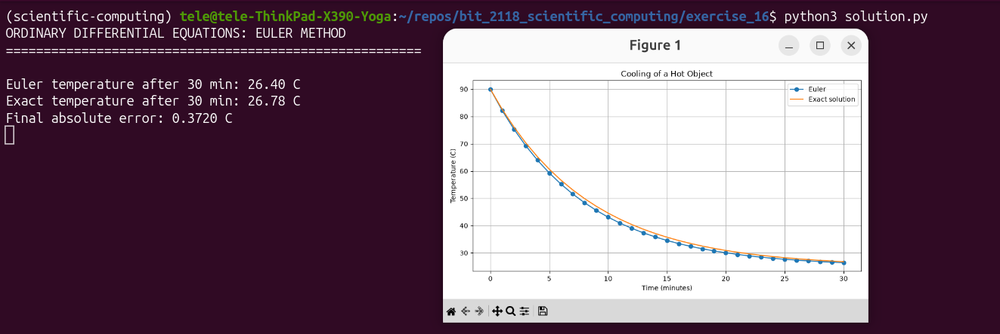

# Exercise 16: Ordinary Differential Equations – Euler Method

## 1. Mathematical Concept

An Ordinary Differential Equation (ODE) describes how a quantity changes with respect to an independent variable, usually time.

A first-order ODE can be expressed as:

```math
\frac{dy}{dt} = f(t,y)
```

Where:

- \(y\) is the quantity being modelled.
- \(t\) is time.
- \(f(t,y)\) describes the rate of change of \(y\).

**Euler's method** is a numerical technique used to approximate solutions to an ODE. It starts with a known initial value and repeatedly advances the solution using:

```math
y_{n+1} = y_n + h f(t_n,y_n)
```

Where:

- \(y_n\) is the current estimated value.
- \(y_{n+1}\) is the next estimated value.
- \(h\) is the time step.
- \(f(t_n,y_n)\) is the rate of change at the current point.

A smaller step size generally improves the accuracy of Euler's method, although it requires more calculations.

### Newton's Law of Cooling

Newton's law of cooling describes how the temperature of an object changes as it approaches the surrounding temperature.

It is expressed as:

```math
\frac{dT}{dt} = -k(T-T_{\text{ambient}})
```

Where:

- \(T\) is the object's temperature.
- \(T_{\text{ambient}}\) is the surrounding temperature.
- \(k\) is the cooling constant.
- \(t\) is time.

The negative sign indicates that when the object is hotter than its surroundings, its temperature decreases.

## 2. Worked Example

Consider the differential equation:

```math
\frac{dy}{dt}=y,\qquad y(0)=1
```

Using Euler's method with a step size of \(h=0.1\):

First step:

```math
y_1 = 1 + 0.1(1) = 1.1
```

Second step:

```math
y_2 = 1.1 + 0.1(1.1) = 1.21
```

The numerical solution advances one step at a time using the previous estimate.

## 3. Real-World Applications

Euler's method and numerical ODE solving are useful in:

- **Population growth:** Modelling changes in population over time.
- **Cooling systems:** Predicting how hot objects cool.
- **Electrical circuits:** Modelling capacitor charging and discharging.
- **Motion:** Simulating changes in position and velocity.
- **Epidemiology:** Modelling the spread of infectious diseases.
- **Engineering:** Simulating physical systems that evolve over time.

## 4. Real-World Problem and Solution Approach

**Problem:**

A hot object is placed in an environment with an ambient temperature of 25°C. Its initial temperature is 90°C.

The objective is to predict how the object's temperature changes over 30 minutes using Newton's law of cooling.

**Solution approach:**

1. Define the ambient temperature, initial temperature, and cooling constant.
2. Express Newton's law of cooling as an ODE.
3. Choose a time step of one minute.
4. Apply Euler's update equation repeatedly to estimate the temperature.
5. Calculate the exact solution for comparison.
6. Determine the final absolute error.
7. Plot the Euler approximation alongside the exact solution.

## 5. Implementation

The program uses:

- **NumPy:** Creates the time array, stores temperature estimates, and calculates the exact solution.
- **Matplotlib:** Plots the numerical and exact temperature curves.

Euler's method calculates each new temperature using the previous temperature and its cooling rate.

The exact solution is also calculated using the analytical solution of Newton's law of cooling:

```math
T(t)=T_{\text{ambient}}+
(T_0-T_{\text{ambient}})e^{-kt}
```

Comparing both solutions helps demonstrate the approximation error introduced by Euler's method.

## 6. Execution Screenshot

The screenshot below shows the program's actual terminal output and the temperature comparison graph.


