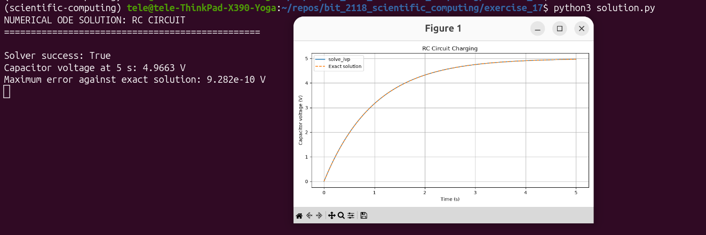

# Exercise 17: Numerical Solution of ODEs Using SciPy

## 1. Mathematical Concept

An Ordinary Differential Equation (ODE) describes how a quantity changes with respect to an independent variable, usually time.

For a first-order ODE:

```math
\frac{dy}{dt}=f(t,y)
```

Numerical ODE solvers approximate the solution over a specified time interval.

SciPy provides the `scipy.integrate.solve_ivp()` function, which solves initial value problems using numerical methods. It supports higher-order methods and adaptive step-size selection, allowing the solver to adjust its internal steps to meet specified accuracy tolerances.

Unlike manually implementing Euler's method, `solve_ivp()` manages the numerical integration process.

### RC Charging Circuit

An RC circuit consists of a resistor and capacitor. When connected to a DC voltage supply, the capacitor charges over time.

The differential equation describing the charging process is:

```math
\frac{dV}{dt}=\frac{V_s-V}{RC}
```

Where:

- \(V\) is the capacitor voltage.
- \(V_s\) is the supply voltage.
- \(R\) is the resistance in ohms.
- \(C\) is the capacitance in farads.
- \(t\) is time in seconds.

The product \(RC\) is called the time constant of the circuit.

The exact solution for the charging voltage is:

```math
V(t)=V_s\left(1-e^{-t/(RC)}\right)
```

This analytical solution can be used to validate the numerical result produced by SciPy.

## 2. Worked Example

Consider an RC charging circuit with:

- Supply voltage: 5 V
- Resistance: 1000 Ω
- Capacitance: 0.001 F
- Initial capacitor voltage: 0 V

The time constant is:

```math
\tau=RC
```

```math
\tau=1000\times0.001=1\text{ s}
```

At one second, the exact capacitor voltage is:

```math
V(1)=5(1-e^{-1})
```

```math
V(1)\approx3.1606\text{ V}
```

The capacitor voltage increases over time, approaching the supply voltage of 5 V.

## 3. Real-World Applications

Numerical ODE solvers are useful in:

- **Control systems:** Modelling the behaviour of dynamic systems.
- **Epidemiology:** Simulating disease transmission.
- **Robotics:** Modelling motion and changing system states.
- **Chemical reactions:** Predicting changes in chemical concentrations.
- **Electrical circuits:** Simulating capacitor charging and discharging.
- **Mechanical systems:** Modelling forces, motion, and vibrations.
- **Engineering simulations:** Predicting how physical systems evolve over time.

## 4. Real-World Problem and Solution Approach

**Problem:**

An electrical engineer wants to model how a capacitor charges when connected to a 5 V DC supply through a resistor.

The capacitor starts with no stored voltage. The engineer wants to estimate its voltage over five seconds.

**Solution approach:**

1. Define the supply voltage, resistance, capacitance, and initial voltage.
2. Express the RC charging equation as a Python function.
3. Create evaluation times using NumPy.
4. Pass the differential equation, initial condition, and time interval to `solve_ivp()`.
5. Calculate the exact charging solution for comparison.
6. Check whether the numerical solver completed successfully.
7. Calculate the maximum absolute error.
8. Plot the numerical and exact solutions.

## 5. Implementation

The program uses:

- **NumPy:** Generates evaluation times and calculates the exact solution.
- **SciPy:** Uses `solve_ivp()` to numerically solve the differential equation.
- **Matplotlib:** Plots the numerical and exact charging curves.

The solver uses relative and absolute error tolerances to control the accuracy of its numerical integration.

The numerical solution is compared with the exact RC charging equation to assess its accuracy.

## 6. Execution Screenshot

The screenshot below shows the program's actual terminal output and the capacitor charging graph.


