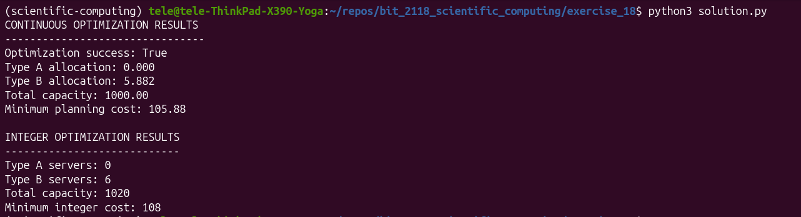

# Exercise 18: Numerical Optimization

## 1. Mathematical Concept

Numerical optimization involves finding the input values that minimize or maximize an objective function while satisfying any specified constraints.

An objective function describes the quantity being optimized. For a minimization problem, the goal is to find an input \(x^*\) such that the objective function has the smallest feasible value.

Optimization problems may also include constraints, such as non-negative variables, minimum production requirements, or limited resources.

For example, a cloud service may want to minimize its operating costs while ensuring that its servers provide sufficient processing capacity.

In Python, `scipy.optimize.minimize` provides numerical methods for solving minimization problems. It supports constraints and variable bounds.

## 2. Example

Consider the function:

```math
f(x)=(x-3)^2+2
```

The minimum occurs at \(x=3\).

When \(x=3\):

```math
f(3)=(3-3)^2+2=2
```

Therefore, the minimum value is 2.

This demonstrates how optimization identifies the input that produces the smallest objective function value.

## 3. Real-World Applications

Numerical optimization is used in several fields, including:

- **Cloud computing:** Allocating computing resources while minimizing operating costs.
- **Network routing:** Finding efficient routes through communication networks.
- **Machine learning:** Adjusting model parameters to minimize prediction errors.
- **Scheduling:** Allocating time and resources efficiently.
- **Engineering design:** Finding designs that satisfy performance requirements at minimum cost.
- **Cost reduction:** Identifying affordable combinations of resources.
- **Parameter tuning:** Selecting suitable values for system parameters.

## 4. Real-World Problem and Solution Approach

### Problem

A cloud service wants to determine the allocation of two server types that minimizes operating costs while meeting a minimum processing-capacity requirement.

The available server types have the following properties:

| Property | Type A | Type B |
|---|---:|---:|
| Cost per unit | 12 | 18 |
| Processing capacity | 100 | 170 |

The cloud service requires at least 1,000 units of processing capacity.

### Solution Approach

Let:

- \(x\) represent the allocation of Type A servers.
- \(y\) represent the allocation of Type B servers.

The objective is to minimize the total operating cost:

```math
C(x,y)=12x+18y
```

The minimum processing-capacity requirement is expressed as an inequality constraint:

```math
100x+170y\geq1000
```

The allocations must also be non-negative:

```math
x\geq0,\qquad y\geq0
```

The solution uses `scipy.optimize.minimize` with the SLSQP optimization method.

The implementation defines the cost function, capacity constraint, and non-negative variable bounds. It then searches for the allocation that minimizes the operating cost.

Finally, the program checks nearby integer combinations to identify an affordable solution when whole server units are required.

## 5. Implementation

The Python program uses NumPy and SciPy to solve the optimization problem.

The `minimize()` function searches for the lowest-cost allocation while respecting the capacity constraint and variable bounds.

The program also evaluates integer combinations because a practical server allocation may require whole units rather than fractional quantities.

## 6. Execution Screenshot

The program displays the optimization status, the calculated allocation of each server type, the resulting processing capacity, and the minimum planning cost.

It also displays the best integer allocation found by checking the possible combinations.


