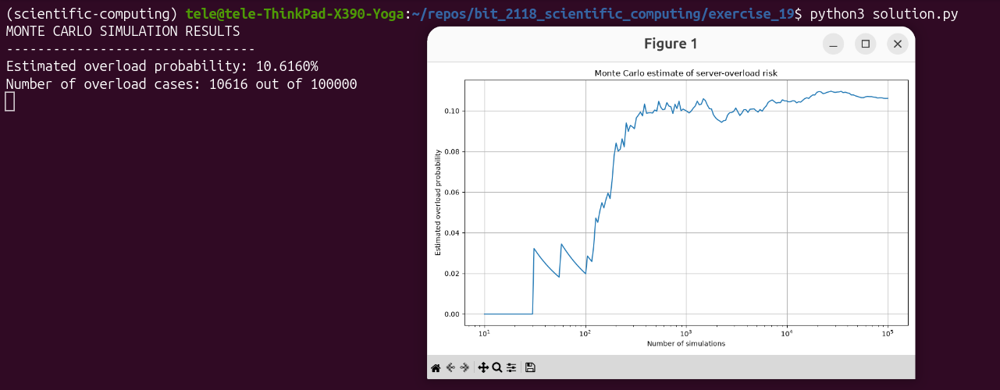

# Exercise 19: Random Numbers and Monte Carlo Methods

## 1. Mathematical Concept

Monte Carlo methods are numerical techniques that use repeated random sampling to estimate quantities such as probabilities, averages, and mathematical integrals.

The main idea is to perform many random experiments and use their outcomes to estimate a quantity of interest.

If an event occurs with probability \(p\), its estimated probability after \(N\) simulations is:

```math
\hat{p}=\frac{\text{Number of times the event occurs}}{N}
```

As the number of simulations increases, the estimated probability generally approaches the true probability.

A classic example of a Monte Carlo method is estimating the mathematical constant \(\pi\).

Random points are generated inside a square containing a quarter circle. The proportion of points that fall inside the quarter circle is used to estimate \(\pi\):

```math
\pi\approx4\times\frac{\text{Points inside the quarter circle}}{\text{Total points}}
```

This demonstrates how random sampling can be used to estimate a mathematical quantity.

## 2. Example

Suppose 10,000 random points are generated inside a square, and 7,850 fall inside the quarter circle.

The estimated value of \(\pi\) is:

```math
\pi\approx4\times\frac{7850}{10000}
```

```math
\pi\approx4\times0.785=3.14
```

The estimate is close to the actual value of \(\pi\), approximately 3.14159.

Increasing the number of random points can improve the stability of the estimate.

## 3. Real-World Applications

Monte Carlo methods are applied in several areas:

- **Risk analysis:** Estimating the likelihood of uncertain events.
- **Reliability engineering:** Evaluating the probability of system failures.
- **Queue simulation:** Studying waiting times and service demand.
- **Finance:** Modelling uncertain market conditions and investment outcomes.
- **Uncertainty analysis:** Understanding how uncertain inputs affect results.
- **Computer graphics:** Simulating lighting and other visual effects.
- **Physical simulations:** Modelling systems involving random behaviour.
- **Numerical integration:** Estimating difficult mathematical integrals.

## 4. Real-World Problem and Solution Approach

### Problem

A network service wants to estimate the probability that its server becomes overloaded when incoming demand is uncertain.

The server has a maximum processing capacity of 1,000 demand units.

The incoming demand is modelled using a normal distribution with:

| Parameter | Value |
|---|---:|
| Mean demand | 850 |
| Standard deviation | 120 |
| Server capacity | 1,000 |
| Number of simulations | 100,000 |

### Solution Approach

The program generates 100,000 random demand scenarios using NumPy's normal distribution function.

Each simulated demand value is compared with the server's capacity.

An overload occurs whenever:

```math
\text{Demand}>1000
```

The overload probability is estimated by dividing the number of overloaded simulations by the total number of simulations:

```math
P(\text{overload})\approx\frac{\text{Overloaded simulations}}{100000}
```

The program also calculates the running overload probability. This shows how the estimate changes as more simulations are performed.

A logarithmic horizontal axis is used to display the convergence behaviour across different simulation counts.

## 5. Implementation

The implementation uses:

- **NumPy:** To generate random demand values, identify overloaded scenarios, and calculate the running probability.
- **Matplotlib:** To plot the estimated overload probability against the number of simulations.

A random number generator is initialized with seed 42 to make the simulation reproducible.

The normal distribution assumes that incoming demand follows a distribution characterized by the specified mean and standard deviation. This is a modelling assumption rather than a guarantee about real network traffic.

## 6. Execution Screenshot

The program displays:

- The estimated server-overload probability.
- The number of overload cases out of 100,000 simulations.

It also generates a graph showing how the estimated overload probability changes as the number of simulations increases.


